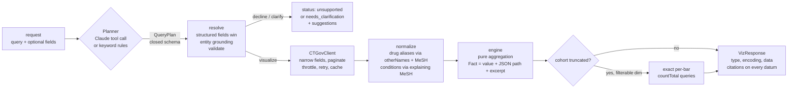

# Design in one page

**Goal:** turn a clinical trials question into a chart spec a frontend can render without guessing, with every
number traceable to an exact field in a ClinicalTrials.gov record.

**Core idea:** the LLM only *plans*. It picks an action (chart, ask, or decline), the trials to fetch, and the
grouping. Deterministic code fetches, normalizes, counts, and builds the spec. A model cannot hallucinate a
number it never produces.

## Guardrails, in the order a request meets them

| Stage | Guard | Failure it prevents |
|---|---|---|
| Planner | Forced tool call against the `QueryPlan` JSON schema, `validate_plan` semantic rules, one self correction round, keyword planner fallback | Malformed or nonsensical plans; an LLM outage taking the service down |
| Planner | `action` = decline for efficacy / safety / "best" / advice / off topic; clarify for unresolved references, comparisons without cohorts, no topic | Charting an answer to a question the data cannot answer |
| Resolve | Every planner entity must appear in the user's words (close spellings allowed, reported as a correction) | The model adding "Keytruda" when the user typed pembrolizumab, silently changing the cohort |
| Retrieve | Zero hits: retry as full text, then return `no_matching_trials` instead of an empty chart | Empty or misleading charts |
| Normalize | Generic and class aliases never link; different MeSH anchors never merge; aliases that are other MeSH substances in the same trial are refused | Sponsor data errors (live example: a pembrolizumab arm listing `otherNames: [Carboplatin, Pemetrexed]`) merging different drugs |
| Normalize | A condition MeSH term is used only if it explains the sponsor's text | Spurious MeSH on live records (oncology trials tagged "Parkinson Disease 4") |
| Count | Exact per-bar API counts when a cohort exceeds `max_records` | Silent sampling bias on large cohorts |
| Output | Titles are templated from the resolved plan; citations are the exact facts that were counted | Titles or citations that disagree with the data |

## Contracts

* **Request:** `query` plus optional typed filters and overrides; unknown fields are rejected.
* **Response:** `status` decides what to render. `ok` carries `visualization {type, title, encoding, data}`;
  the other statuses carry `clarification {reason, message, suggestions}`. A renderer reads
  `encoding.<channel>.field` and never branches on question type.
* **Datum:** values plus `nct_ids` (every contributing trial) and `citations` (`nct_id`, JSON `field` path,
  exact `excerpt`, `url`). Exact count bars add `count_method` and `sample_count`.

## Evidence

* 55 hermetic tests, including normalization and filter syntax checked against **live API records**
  (`tests/fixtures/ctgov_sample.json`, `essie_probe_counts.json`, captured with `scripts/probe_api.py`).
* Planner evals on three sets: dev (30), held out (15), adversarial (20: out of scope, ambiguous, misspelled,
  trap wording, prompt injection). See the README for scores.
* A CI workflow (`.github/workflows/ci.yml`) runs the tests and the keyword planner eval with regression floors once the repo is on GitHub.
